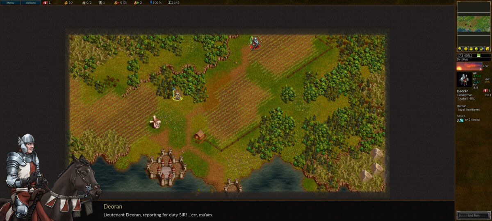
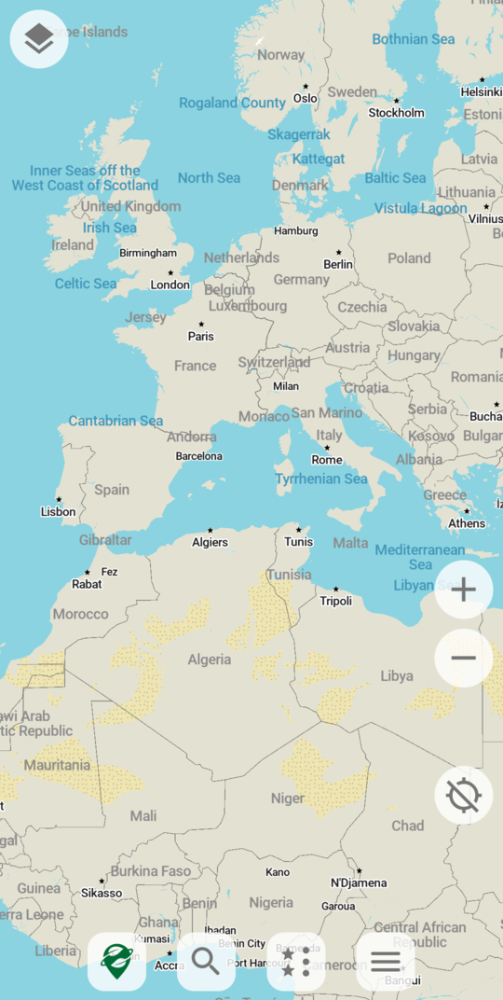
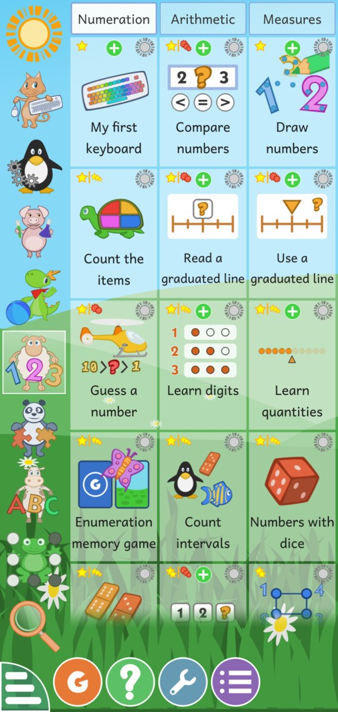
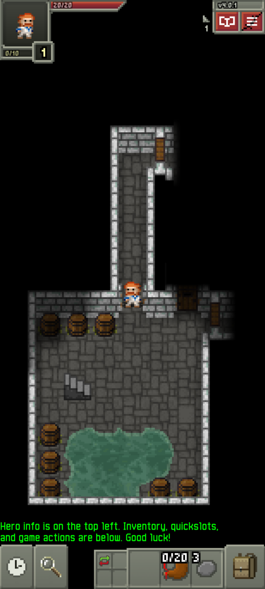
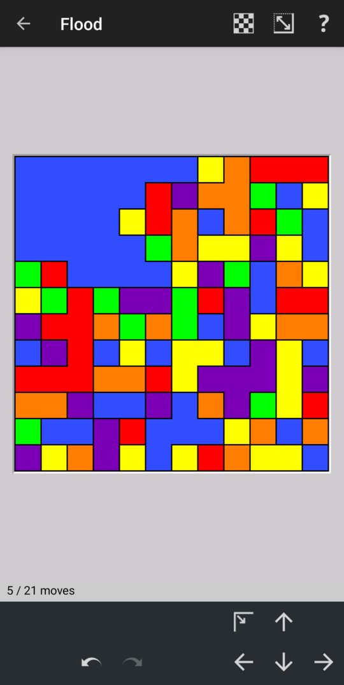
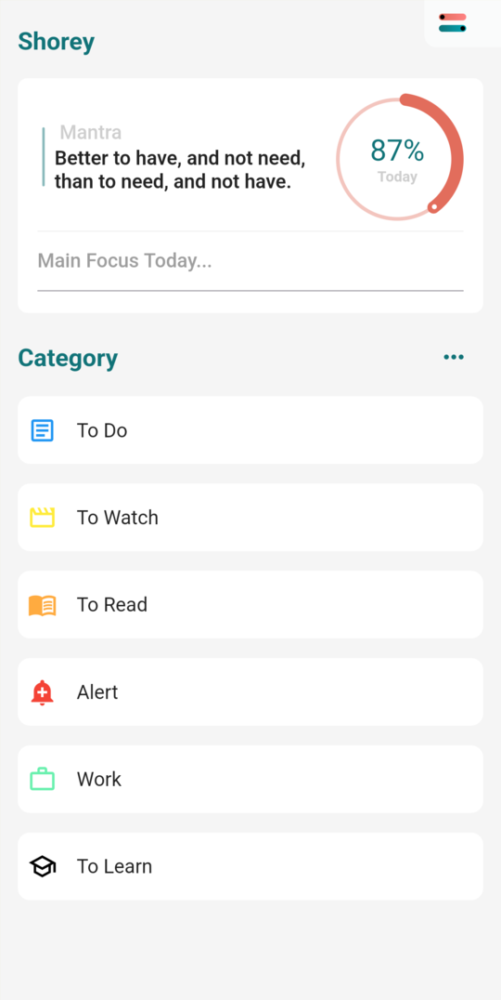
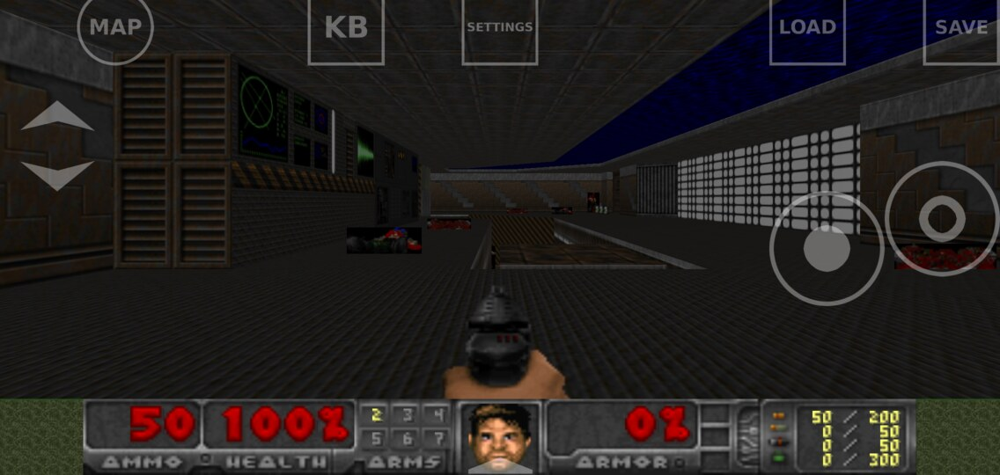
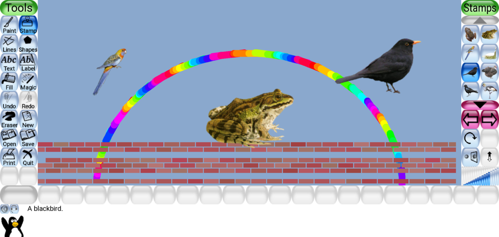
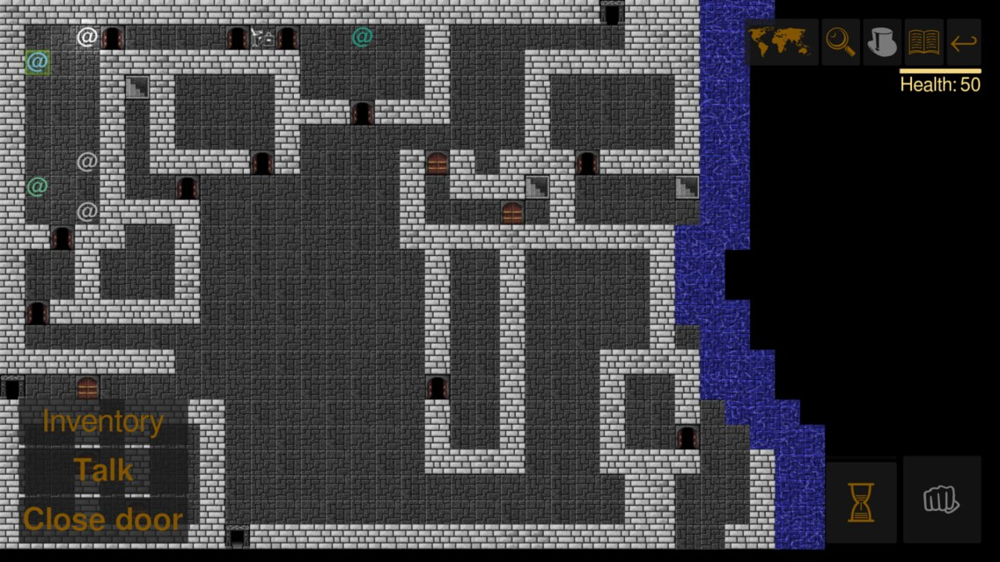
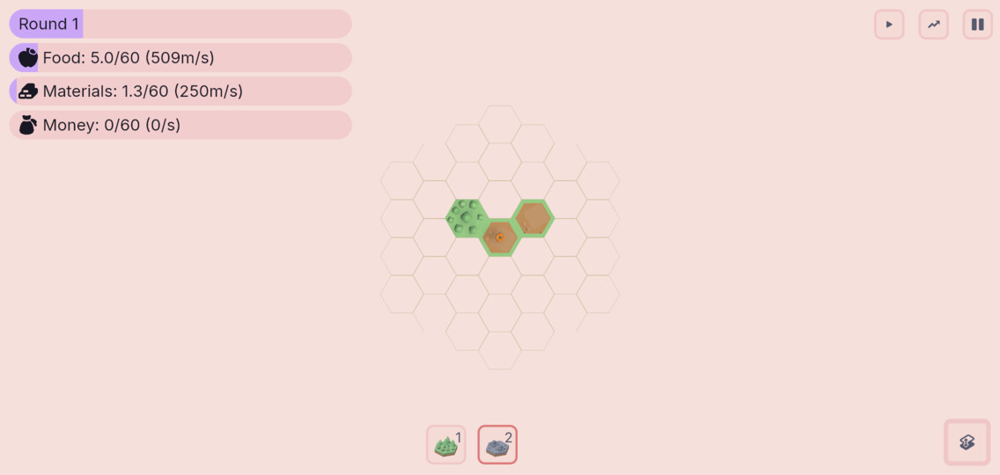

# tsugiki

AOT recompiler that turns ARM-64-only android apps into x86-64 APKs.

Native bridges like libhoudini or libndk_translation translate arm64 code while
the app runs, and they have to be part of the system image. tsugiki translates
an app's `lib/arm64-v8a/*.so` ahead of time into x86_64 libraries instead, so the
result is a plain x86_64 APK that installs on Waydroid, the emulator or
Android-x86 as is.

<p align="center">
  
  <br>
  
  
  
  
  
  <br>
  
  
  <br>
  
  
</p>

The Battle for Wesnoth, Organic Maps, GCompris (Qt 6), Shattered Pixel Dungeon,
Simon Tatham's Puzzles, Shorey (Flutter), Freedoom, Tux Paint, Revengate
(Godot 4) and TerraTactician Expandoria (Rust and Bevy), F-Droid builds that
only ship arm64 libraries, translated by tsugiki and running on an x86_64
Android 15 emulator that can't run arm64 code at all. Wesnoth, GCompris,
Shorey, Freedoom, Revengate and TerraTactician have no x86_64 build anywhere on
F-Droid. Map data © OpenStreetMap contributors.

## Status

Early, but real apps run. What works so far:

- integer, FP and AdvSIMD code, one C++ function per guest function, built with
  the NDK into an x86_64 library that carries the original image
- finding code through `.eh_frame`, symbols, relocations, code pointers, jump
  tables and the function list in Dart's AOT snapshots, so Flutter apps run too
- an interpreter for whatever was still missed, with the same semantics as the
  translated code, that hands back to translated code as soon as it can
- calls both ways between translated code and the x86_64 system: JNI, callbacks,
  `dlopen`/`dlsym`, raw function pointers, signal handlers, and the structs and
  constants that differ between the two (`stat`, `epoll_event`, `fenv_t`, `open`
  flags)
- C++ exceptions, thread locals, `long double`, executables shipped as `lib*.so`
- C, C++ and Rust, including the helpers LLVM's machine outliner makes, which
  hand condition flags back to their caller
- Qt 6 apps: their per-ABI library lists get pointed at x86_64, and code that
  reads its own `.so` files sees the arm64 originals
- python-for-android (Kivy) apps: the extension modules packed inside their
  `libpybundle.so` get translated too
- JITs that can fall back, like QML's and PCRE2's, are refused executable memory
  and interpret instead; ones that can't, like LuaJIT's, get their code run by
  the interpreter

Not yet:

- signal handlers get the x86_64 context, so runtimes that scan the stack from
  one (Mono, Unity) won't work
- code generated at run time only ever runs in the interpreter, which is many
  times slower than translated code
- speed: a tight loop like a CRC runs at native speed, but code full of small
  calls is about five times slower for now

## Usage

```
tsugiki apk app.apk -o app-x86_64.apk
adb install app-x86_64.apk
```

`-j n` sets how many compiles run at once, and `--force` translates an APK that
already has x86_64 libraries anyway. Organic Maps, with 15 MB of arm64 code,
takes about two minutes with `-j 8`, and Revengate's 60 MB Godot engine about
ten. The APK gets signed with a key of your own,
made once in `~/.local/share/tsugiki`.

```
tsugiki info app.apk          # libraries, functions, jump tables
tsugiki build lib*.so -o out  # just the x86_64 libraries
```

## Building

Needs CMake, a C++20 compiler and libzip. The tests also need clang, lld and
llvm-readelf, which build arm64 sample libraries on the spot, no NDK needed.

```
cmake -S . -B build
make -C build -j
./build/tests/tsugiki_tests
```

Translating needs the Android NDK (`ANDROID_NDK_HOME` or the newest one in
`~/Android/Sdk/ndk`), and making APKs needs the SDK's build-tools and openssl.
`tests/android/run.sh` checks translated code against native builds on a device
or emulator, and `tests/android/sweep.py` translates arm64-only F-Droid apps in
bulk and checks that they start. `tests/difftest/run.sh build lib.so` runs every
instruction a library has both translated and interpreted, from random states,
and prints the ones that disagree.

## Note

Translated APKs are the app's own code, so they're for your machine only. Never
share them.
